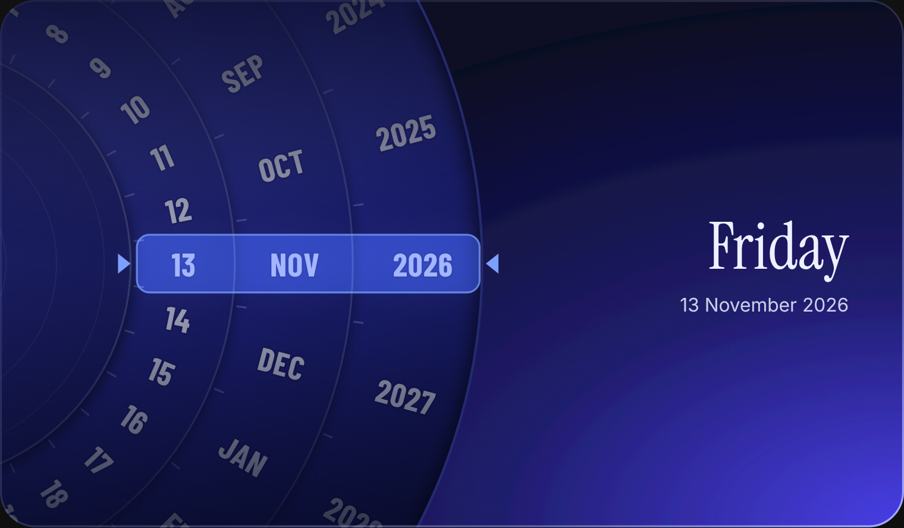

# Objects

Interactive pieces inspired by real-world things — paper mechanisms, old devices, everyday objects — rebuilt for the web.
Every piece is a single file with no dependencies. Preview it, copy it, use it.

Designed and built by [Saikiran Rudra](https://github.com/Saikiran9252).

## Objects

| | Name | What it is |
|---|---|---|
|  | [Calendar Wheel](calendar-wheel) | A date picker built like a paper volvelle. Drag the rings; the weekday works itself out. |

## Using a piece

Each folder has:

- `index.html` — the live preview, with the code ready to copy
- `<name>.js` — the component itself, one file, no dependencies
- `README.md` — how to drop it into your own site

## License

MIT. Use it in personal and commercial work. A credit is appreciated, not required.
