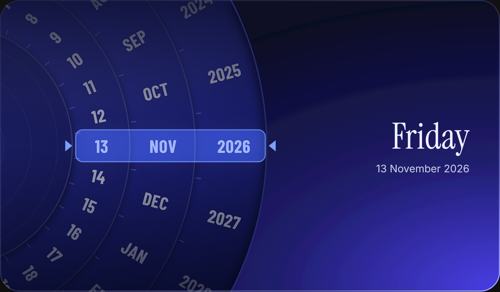

# Calendar Wheel

A date picker built like a paper volvelle. Three rings — date, month and year — turn on one pivot hidden off the card's edge. Drag a ring; the band in the middle is your date, and the weekday works itself out.



## Use it

```html
<script src="calendar-wheel.js"></script>

<calendar-wheel value="2026-11-09" sound></calendar-wheel>

<script>
  document.querySelector("calendar-wheel")
    .addEventListener("change", e => console.log(e.detail.date)); // "YYYY-MM-DD"
</script>
```

- `value` — the starting date (`YYYY-MM-DD`). Defaults to today.
- `sound` — a soft click on every stop. Leave it out for silence.
- `input` event — fires on every stop while turning.
- `change` event — fires once the wheel settles.

## Behaviour

- Flicks carry momentum; every stop snaps with a small overshoot.
- Rolling the date past 31 moves the month on; rolling past December moves the year.
- Impossible dates (31 June, 29 Feb in a normal year) slide back to the last real day.
- Works with mouse, touch, scroll wheel and keyboard (arrow keys, Page Up/Down).
- Respects reduced-motion settings.

## Restyle it

Everything is a CSS variable. Midnight, the default look:

```css
calendar-wheel {
  --cw-card: #070920;   --cw-card-2: #4a3ff0;   --cw-rim: #a7adff;
  --cw-card-ink: #eef0ff;   --cw-card-muted: #9aa1e6;   --cw-edge: #232a6e;
  --cw-grad-a: #4248d6;   --cw-grad-b: #262b9a;   --cw-grad-c: #12165a;
  --cw-ink: #e6e9ff;   --cw-tick: #b6bdff;   --cw-glow: #5b8bff;
  --cw-band: #7da0ff;   --cw-band-fill: rgba(70,110,255,.42);
}
```

The preview page (`index.html`) has a second palette and a custom-colour maker that writes these variables for you.

Fonts it looks for: Barlow Condensed (rings), Instrument Serif (weekday), Inter (date line). It falls back to system fonts without them.
